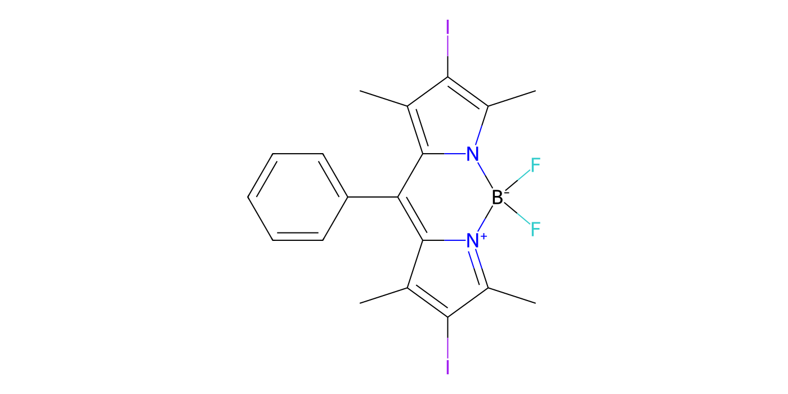
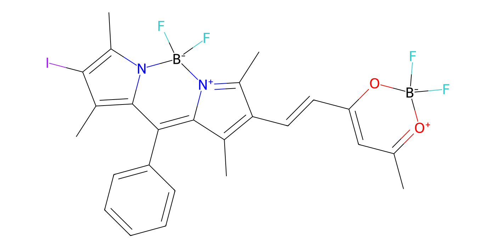
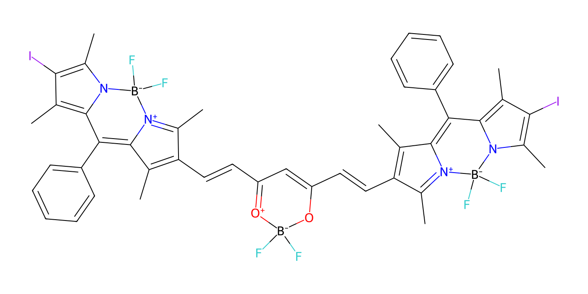

# Song 等（2025）分子结构提取与 RDKit 重绘

**状态：候选结构，尚未完成独立逐键复核。** 来源为用户提供的正文第 2 页及 SI 的 Scheme S1（印刷页 S5，PDF 第 6 页）。论文：Song 等，*Angew. Chem. Int. Ed.* 2025, 64, e202418097，[DOI](https://doi.org/10.1002/anie.202418097)。本文件不复制原文或 SI 图片。

图和 SMILES 是依据 SI 示意图人工构建、再由 RDKit 2026.09.1 解析与重绘的候选；不是 OCSR 自动识别结果。解析成功和原子计数一致并不证明与原图完全一致。图形旋转、共振式及形式电荷显示可能与原图不同。**双键 E/Z 构型目前未编码，图片上看似某个构型的排布不能当作确定的立体结果。** 不用于确定性计算或作为最终结构，直到与原图、SI及原始结构文件逐键核对。

## IB



- 原图读取：一个 BODIPY 核心，两侧各一个碘，meso 位连接苯基。
- 候选分子式：C₁₉H₁₇BF₂I₂N₂；总形式电荷 0。

```text
CC1=C(I)C(C)=[N+]2C1=C(c1ccccc1)c1c(C)c(I)c(C)n1[B-]2(F)F
```

## IB-BF₂



- 原图读取：一个末端含碘 BODIPY，通过含双键的碳链连接 BF₂ 配位环，另一端保留甲基。
- 候选分子式：C₂₅H₂₃B₂F₄IN₂O₂；总形式电荷 0；连接链双键立体化学未指定。

```text
CC1=[O+][B-](F)(F)OC(C=CC2=C(C)C3=C(c4ccccc4)c4c(C)c(I)c(C)n4[B-](F)(F)[N+]3=C2C)=C1
```

## IB-BF₂-IB



- 原图读取：中央 BF₂ 配位环两侧分别经含双键的碳链连接一个含碘 BODIPY。
- 候选分子式：C₄₅H₃₉B₃F₆I₂N₄O₂；总形式电荷 0；两个连接链双键立体化学未指定。

```text
CC1=C(C=CC2=CC(C=CC3=C(C)C4=C(c5ccccc5)c5c(C)c(I)c(C)n5[B-](F)(F)[N+]4=C3C)=[O+][B-](F)(F)O2)C(C)=[N+]2C1=C(c1ccccc1)c1c(C)c(I)c(C)n1[B-]2(F)F
```

## 验证和限制

- 三个候选均通过 RDKit sanitization、分子式计算及二维绘图；硼、碘原子计数分别为 1/2、2/1、3/2，与 SI 示意图目视计数一致。未独立验证每个键级、结构的实际共振描述或立体化学。
- 形式电荷用于使候选分子图的硼配位满足 RDKit 价态表示，并不直接代表电子实际局域化。图上中央环 O⁺/B⁻ 和 BODIPY N⁺/B⁻ 的写法可能与原图不同。
- SI 的 Figure S7 显示两个质谱图；本次未完成峰归属及离子类型核查，不能以质谱认定候选分子式或完整连接。
- SI S3 的化合物 1 收率文字出现 46% 和 88.3%；Scheme S1 写 46%。SI S4 的化合物 2 反应时间文字为 2 h，而 Scheme S1 写 6 h。保留差异，待原始记录确认。
- SI S3 表示由于溶解性问题未获得 IB-BF₂-IB 的 ¹³C NMR。
- 首次读取、结构对照与测试状态见 [试验记录](song-2025-first-case.md)。

下一步：使用作者原始 ChemDraw/Molfile 或独立专家逐键核对，包括 BODIPY 连接位置、中央配位环、双键 E/Z、取代基、每一原子和化学键；再与可确认的表征证据对照。
