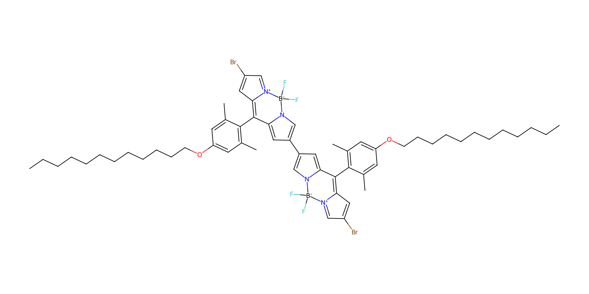
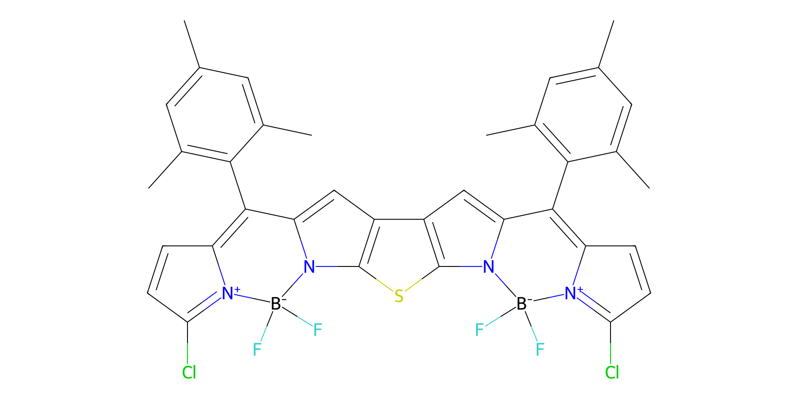
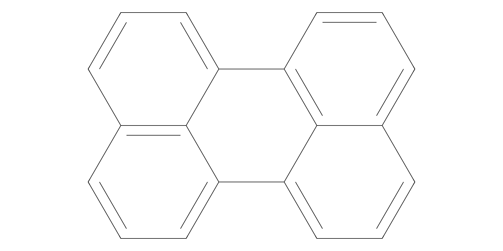
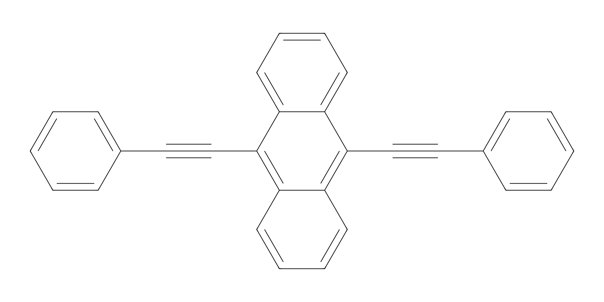

# Red-to-Blue Photon Upconversion：分子结构提取

## 文献与范围

Yun Wu 等，*Red-to-Blue Photon Upconversion Based on BODIPY Derivative Photosensitizers*，*Chemistry – A European Journal*，2026，[DOI: 10.1002/chem.71254](https://doi.org/10.1002/chem.71254)。

依据用户提供的正文 PDF，主要读取第 2 页 **Scheme 1b**。该图展示本研究使用的两个敏化剂 2G、FD 和两个湮灭剂 Perylene、BPEA；Scheme 1a 中的结构属于既往文献，不作为本研究样品。本次未获得 SI，未读取 Scheme 1b 之外的结构文件，也未自动运行图像识别模型。

## 提取结果

| 分子 | 研究角色 | 图中可辨结构 | 状态 |
| --- | --- | --- | --- |
| **2G** | 三重态敏化剂 | 两个 BODIPY 单元通过单键连接；两端各一个 Br。每个 BODIPY 的芳基带有 `OC₁₂H₂₅` 取代基。 | 主要模块、连接类型和溴的数量经原图目视核对；后文给出手工候选和重绘，全部取代位点及构象未独立确认。 |
| **FD** | 三重态敏化剂 | 两个 BODIPY 单元与中央含 S 的稠合结构连接；图中两端各标有一个 Cl。 | 主要模块和氯的数量经原图目视核对；后文给出手工候选和重绘；中央稠环、硼氮连接和全部键级仍待逐键核对。 |
| **Perylene（苝）** | 湮灭剂 | 多环稠合芳烃；分子式 C₂₀H₁₂。 | 与原图及公开数据库结构对照；下列字符串经 RDKit 解析。 |
| **BPEA** | 湮灭剂 | 9,10-双(苯乙炔基)蒽；分子式 C₃₀H₁₈。 | 与原图及公开数据库结构对照；下列字符串经 RDKit 解析。 |

论文将 FD 描述为不含 Br、I 的“heavy-atom-free”敏化剂，但 Scheme 1b 中明确标有两个 Cl。因此，在复述作者的术语时不能写成“FD 完全不含卤素”，其具体术语范围应保留原文语境。

## 机器可读结构

下列 SMILES 来源于公开标准化合物信息，经 **RDKit 2026.09.1** 解析并计算分子式；与正文 Scheme 1b 目视对照。RDKit 可解析不构成对原图每条键的独立证明。

### Perylene

```text
c1cc2cccc3c4cccc5cccc(c(c1)c23)c54
```

RDKit 分子式：`C20H12`。由 [NIST Perylene 的 InChI](https://webbook.nist.gov/cgi/cbook.cgi?ID=198-55-0) 转换。

### BPEA

```text
C1=CC=C(C=C1)C#CC2=C3C=CC=CC3=C(C4=CC=CC=C42)C#CC5=CC=CC=C5
```

RDKit 分子式：`C30H18`。SMILES 来源：[PubChem CID 82338](https://pubchem.ncbi.nlm.nih.gov/compound/82338)。

### 2G 和 FD：候选 SMILES 与 RDKit 重绘

根据正文 Scheme 1b 手工构建候选分子图，并用 RDKit 2026.09.1 完成解析、分子式计算和绘图；不是 OCSR 识别结果。对照了原图中的主要模块、硼和卤素数量。**未取得 SI 或原始结构文件，仍须逐键核对：2G 的芳基和两条 C₁₂H₂₅ 链，以及 FD 的稠环、配位表示、键级和取代位点。** RDKit 可解析不等于原图识别正确。二维图的旋转和布局不代表真实三维构象；形式电荷用于硼配位表示，不表示电荷必然局域。

#### 2G



候选分子式：C₅₈H₇₄B₂Br₂F₄N₄O₂；形式电荷总和为 0。

```text
CCCCCCCCCCCCOc1cc(C)c(C2=C3C=C(Br)C=[N+]3[B-](F)(F)n3cc(-c4cc5n(c4)[B-](F)(F)[N+]4=CC(Br)=CC4=C5c4c(C)cc(OCCCCCCCCCCCC)cc4C)cc32)c(C)c1
```

#### FD



候选分子式：C₃₆H₂₈B₂Cl₂F₄N₄S；形式电荷总和为 0。

```text
Cc1cc(C)c(C2=C3C=CC(Cl)=[N+]3[B-](F)(F)n3c2cc2c4cc5n(c4sc23)[B-](F)(F)[N+]2=C(Cl)C=CC2=C5c2c(C)cc(C)cc2C)c(C)c1
```

### 苝和 BPEA 的重绘





## 验证边界

- 目视读取、人工构建与 RDKit 解析分别报告；只有 Perylene、BPEA 使用了外部数据库标准结构。
- 用户提供的正文 PDF 及其原图未上传到仓库；本文件仅记录文字、文献来源和候选结构信息。
- 未根据结构图单独推断 ISC 量子产率、轨道分布或能级，也未核验 SI 的数据。
